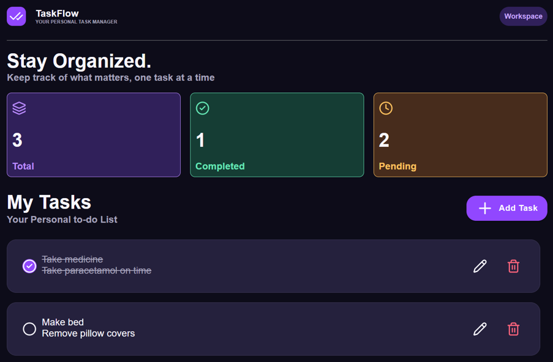
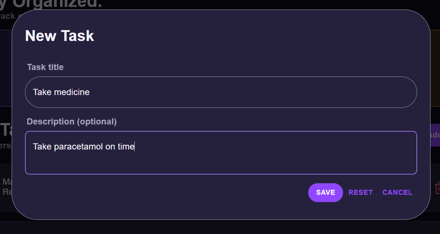
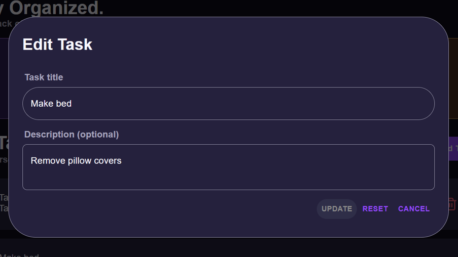
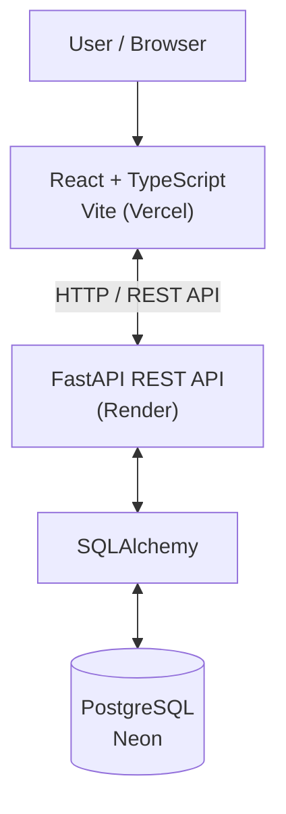

# TaskFlow

A simple full-stack task management application built with React, TypeScript, FastAPI, and PostgreSQL. TaskFlow allows users to create, view, update, delete, and track tasks through a clean, single-page dashboard.

## Live Demo

- **Frontend:** [https://taskflow-six-pi.vercel.app/](https://taskflow-six-pi.vercel.app/)
- **Backend API:** [https://taskflow-jdy2.onrender.com](https://taskflow-jdy2.onrender.com)
- **API Documentation:** [https://taskflow-jdy2.onrender.com/docs](https://taskflow-jdy2.onrender.com/docs)

## Screenshots

### Dashboard

Displays the task summary cards and the list of tasks, including completed and pending tasks.



### Add Task

Create a new task by providing a title and an optional description.



### Edit Task

Update the details of an existing task.



## Features

- **Dashboard:** View all tasks in one place.
- **Task Summary:** Track total, completed, and pending tasks through summary cards.
- **Create Tasks:** Add tasks with a title and optional description.
- **View Tasks:** Display tasks with their current completion status.
- **Edit Tasks:** Update existing task details.
- **Delete Tasks:** Remove tasks when they are no longer needed.
- **Task Status:** Mark tasks as completed or pending.

## Tech Stack

| Layer             | Technologies            |
| ----------------- | ----------------------- |
| Frontend          | React, TypeScript, Vite |
| UI Icons          | Lucide React            |
| API Communication | Axios                   |
| Backend           | Python, FastAPI         |
| ORM               | SQLAlchemy              |
| Database          | PostgreSQL              |
| Database Hosting  | Neon                    |
| Backend Hosting   | Render                  |
| Frontend Hosting  | Vercel                  |
| Version Control   | Git, GitHub             |

## Application Architecture

TaskFlow follows a simple three-tier architecture.



**Request flow:**

1. The user interacts with the React frontend.
2. The frontend sends HTTP requests to the FastAPI backend.
3. FastAPI processes the requests and uses SQLAlchemy to interact with PostgreSQL.
4. The backend returns the response to the frontend.
5. The dashboard updates based on the returned data.

## Running the Project Locally

### Prerequisites

Make sure you have the following installed:

- Python
- Node.js and npm
- PostgreSQL

### 1. Clone the Repository

```bash
git clone https://github.com/AshNiz24/taskflow.git
cd taskflow
```

### 2. Set Up the Backend

Navigate to the backend directory:

```bash
cd backend
```

Create and activate a virtual environment:

```bash
python -m venv .venv
```

On Windows:

```bash
.venv\Scripts\activate
```

On macOS/Linux:

```bash
source .venv/bin/activate
```

Install the dependencies:

```bash
pip install -r requirements.txt
```

Configure your database connection in the backend `.env` file using the environment variable expected by your database configuration.

Start the FastAPI development server:

```bash
uvicorn app.main:app --reload
```

The backend API will be available at:

`http://127.0.0.1:8000`

API documentation:

`http://127.0.0.1:8000/docs`

### 3. Set Up the Frontend

Open a new terminal and navigate to the UI directory:

```bash
cd ui
```

Install the dependencies:

```bash
npm install
```

Create a `.env` file inside the `ui` directory:

```env
VITE_API_BASE_URL=http://127.0.0.1:8000
```

Start the Vite development server:

```bash
npm run dev
```

The frontend will be available at:

`http://localhost:5173`

## Deployment

TaskFlow is deployed using the following services:

| Component           | Platform |
| ------------------- | -------- |
| Frontend            | Vercel   |
| Backend             | Render   |
| PostgreSQL Database | Neon     |
| Source Code         | GitHub   |

### Production Environment

The production frontend communicates with the deployed FastAPI backend through the `VITE_API_BASE_URL` environment variable.

The production frontend environment variable is configured as:

```env
VITE_API_BASE_URL=https://taskflow-jdy2.onrender.com
```

The backend connects to the hosted PostgreSQL database on Neon using its database connection configuration.
